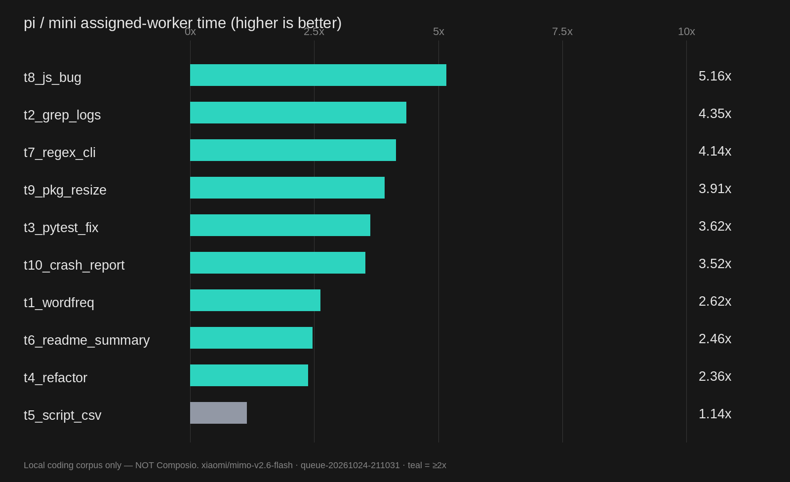
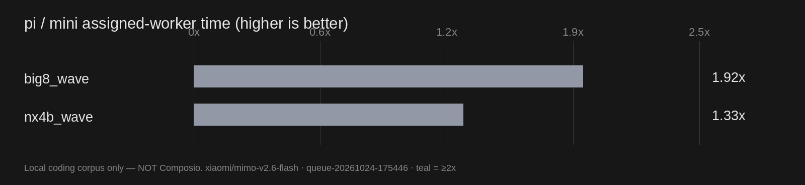
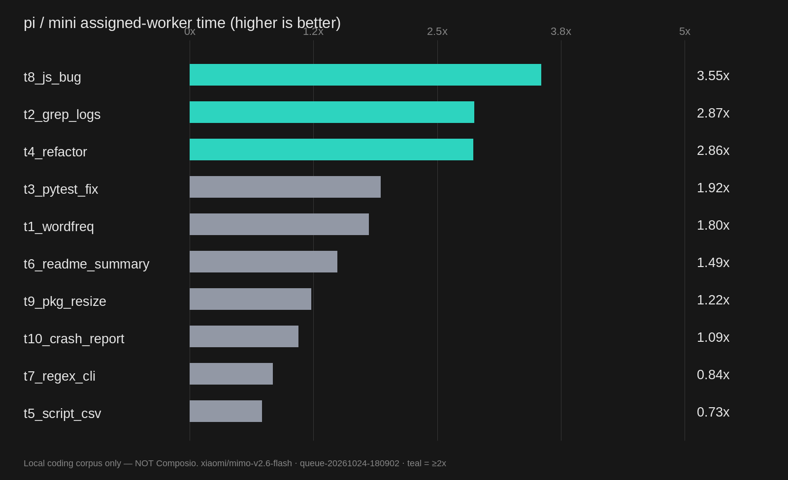

# mini-tui frente a pi: objetivo ×2, pass rate y benchmark Composio

Fecha: 24 de octubre de 2026. Modelo de las comparaciones de velocidad:
`xiaomi/mimo-v2.6-flash` / `xiaomi-anthropic/mimo-v2.6-flash`, ambos en la superficie
Anthropic del token plan de Singapur. Las ejecuciones usaron copias limpias de cada tarea,
verificadores deterministas y brazos intercalados.

## Conclusión ejecutiva (actualizada tras eager)

**La configuración final sí cumple la regla de velocidad worker con calidad igualada.** La
validación experimental `queue-20261024-211031` midió **2,85× worker y 30/30 PASS en mini frente
a 30/30 PASS en pi**. Tras endurecer el veredicto, la regresión final `queue-20261024-222316`
confirmó **2,43× worker / 1,84× e2e**, 10/10 PASS en ambos y MiMo V2.6 Flash. E2E quedó por
debajo de ×2 porque el dispatcher añade tiempo; no se presenta como si también fuese ×2.

El resultado final no salió a la primera. La validación previa midió 1,52×, fast close llegó a
1,89× y el cierre temprano eager alcanzó 2,85×. La clave fue ejecutar el verificador íntegro
cuando el trabajo ya está completo y cerrar sin otra llamada al modelo ni exploración posterior.
El verificador sigue siendo obligatorio: `verify.sh` debe devolver 0 y una línea `PASS`
independiente; los fallos y tracebacks se rechazan incluso cuando un pipeline enmascara el
código de salida o cuando `some tests PASS` aparece antes de un `AssertionError`.

Las tres repeticiones de la configuración experimental dieron aproximadamente 2,84×, 2,35× y
más de 2×; la suma de medianas por tarea fue 111,1 s mini worker / 171,2 s mini e2e / 316,4 s pi.
El A/B worker-only previo ya había dado **2,18× en dos repeticiones consecutivas**, 20/20 PASS
frente a 20/20. Eager está ahora activo por defecto, con opt-out para suites lentas.

| experimento | mini PASS | pi PASS | pi / mini worker | pi / mini e2e | lectura |
| --- | ---: | ---: | ---: | ---: | --- |
| histórico `queue-20261024-031939` | 30/30 | 30/30 | **2,26×** | 1,55× | mejor resultado histórico |
| validación `queue-20261024-151724` | 30/30 | 30/30 | **1,52×** | 1,17× | no reproduce ×2 |
| regresión final `queue-20261024-180902` | 10/10 | 10/10 | **1,76×** | 1,22× | gate validado; una repetición |
| Kimi K3 `queue-20261024-184644` | 10/10 | 10/10 | **1,19×** | 0,92× | misma clave y modelo directo en ambos |
| **MiMo eager `queue-20261024-211031`** | **30/30** | **30/30** | **2,85×** | 1,85× | **objetivo worker cumplido** |
| **Regresión estricta `queue-20261024-222316`** | **10/10** | **10/10** | **2,43×** | 1,84× | **confirmación final** |
| escala, routing antiguo `queue-20261024-165347` | 2/3 | 3/3 | 0,65× | 0,58× | workers serializados + FAIL |
| directorios disjuntos, sin gate `queue-20261024-172124` | 1/2 | 2/2 | 2,09× | 1,76× | velocidad sin calidad suficiente |
| routing + closure gate `queue-20261024-175446` | 2/2 | 2/2 | **1,64×** | 1,18× | calidad igualada; ×2 no global |

Los experimentos tienen uno a tres intentos por celda. Los de escala final tienen uno: son una
validación funcional y una medición observada, no una garantía estadística.

## Qué mostró el análisis del backend

1. **El tiempo dominante es el modelo, no el overhead de Rust.** Más turnos y turnos más largos
   explican la mayor parte de la variabilidad. Optimizar serialización o micro-overhead no puede
   crear por sí solo un ×2.
2. **La asignación directa tiene dos tiempos distintos.** `worker` mide desde el inicio del primer
   subagente hasta el final del último; `e2e` añade el dispatcher. Presentar solo el segundo como
   si fuese el primero inflaría el resultado. En fan-out se usa el makespan de toda la oleada.
3. **Un `cwd` compartido elimina el paralelismo.** El dispatcher creaba cuatro u ocho workers con
   la misma raíz. La protección de una tarea por árbol de directorios, necesaria para evitar
   corrupción, los ejecutaba en serie.
4. **Dividir cuando no hay aislamiento también es malo.** Ocho workers que comparten root pagan
   ocho arranques sin ejecutarse en paralelo. En ese caso el dispatcher debe asignar un solo
   worker para todo el trabajo.
5. **Un `Submitted` no implicaba verificación.** En `big8` el agente hizo checks propios pero no
   ejecutó el verificador suministrado y entregó dos informes incorrectos. Desactivar el juez LLM
   ahorra tiempo, pero hace falta una comprobación determinista cuando la tarea la proporciona.

## Cambios retenidos

### 1. Fan-out solo con directorios disjuntos

`agent/src/minisweagent/config/dispatcher.yaml` ahora exige el directorio existente más específico
para cada parte. Si los directorios se solapan, crea un solo worker en vez de forzar N tareas
serializadas. `allow_overlap: false` lo hace verificable: la cola rechaza fan-out solapado y el
dispatcher debe reintentar como una sola tarea. El trabajo secuencial existente sigue permitido
por defecto; solo se exige el flag en partes independientes. No se relajó la protección de carpetas
ni se inventaron directorios.

En `nx4b`, los cuatro proyectos recibieron `part1_strkit`, `part2_tpl`, `part3_fsm` y
`part4_statkit`, y llegaron a ejecutarse cuatro workers simultáneamente. En `big8`, donde todas
las entradas y salidas comparten root, el dispatcher eligió correctamente un solo worker.

### 2. Closure gate determinista

`agent-rs/src/agent.rs` captura al inicio el primer verificador disponible (`verify.sh`,
`run_tests.sh`, `verify`, `check.sh`, `test.sh`) y su SHA-256. En la propuesta de salida:

- vuelve a comprobar el hash, para no aceptar un checker sustituido o borrado;
- ejecuta el checker en el entorno real, sin llamadas adicionales al modelo;
- si falla, devuelve la salida al worker para una reparación dirigida;
- tras tres rechazos (configurable) termina como `TaskVerifierFailed`, nunca como éxito;
  el proceso sale con código no cero para que la cola marque la tarea como error;
- registra los intentos en `info.task_verifier`, separado del antiguo `goal_oracle` LLM.

Es independiente del juez LLM, que sigue desactivado para workers. Se puede desactivar con
`MINI_AGENT_TASK_VERIFIER=off`; `MINI_AGENT_TASK_VERIFIER_MAX_FAILURES` cambia el límite.

Pruebas de `agent-rs/tests/task_verifier.rs` con el binario real y un modelo scriptado:

- PASS preexistente → `Submitted`, una sola llamada al modelo y una ejecución del checker;
- FAIL → reparación → PASS, con el error visible en la conversación;
- checker reemplazado por un `exit 0` → `TaskVerifierFailed`.

Resultado: **7/7 tests PASS**. La ejecución real de `big8` registró `captured → rejected → passed`;
el primer cierre fue rechazado por formato de los informes y el segundo ya fue correcto.

### 3. Cierre temprano (fast close + eager)

El fast close evita una respuesta final cuando el último comando es el verificador íntegro y
pasa. Eager va un paso más allá: después de un paso de trabajo ejecuta el verificador y, si el
estado ya pasa, cierra aunque el modelo haya usado `pytest`, `node --test` o un script propio.
Los fallos eager no se inyectan en el contexto; el trabajo continúa con normalidad.

El A/B worker-only (`worker-ab-20261024-205716`) dio **2,18× en las dos repeticiones** (suma de
medianas 106,5 s frente a 231,7 s), 20/20 PASS frente a 20/20. La validación real en cola
(`queue-20261024-211031`) confirmó **2,85× worker / 1,85× e2e**, 30/30 frente a 30/30, con solo
una solicitud hedged registrada. `MINI_AGENT_VERIFIER_EAGER=0` desactiva eager y
`MINI_AGENT_VERIFIER_FAST_CLOSE=0` desactiva todo el cierre rápido.

### 4. Evidencia del runner

- Cada repetición conserva eventos, trayectorias y workspaces separados.
- `methodology.json` guarda commit, estado dirty, modelo, corpus, timeout y SHA-256 del binario.
- Un `exit != 0` o cero turnos de pi detiene la campaña como ejecución inválida; no se convierte en
  un falso FAIL de tarea. Un timeout después de trabajo real sí es un FAIL ordinario.
- `verify.sh` se restaura desde la copia prístina antes de puntuar, usando el ID original incluso
  en directorios `.rN`; la modificación queda registrada.
- Un fan-out se mide desde el primer worker hasta el último, no solo por la primera tarjeta.
- `analysis.json`, `REPORT.md`, `speedup.png` y `pass-rate.png` se generan desde las filas crudas.

## Corpus base: velocidad y dificultad

La validación `queue-20261024-151724` usó diez tareas × tres repeticiones por brazo, 60 celdas.
Todas pasaron el verificador en ambos harnesses. Las etiquetas son editoriales por forma de tarea,
no una escala calibrada de dificultad humana.

| dificultad | tareas | mini PASS | pi PASS | pi / mini worker | pi / mini e2e |
| --- | ---: | ---: | ---: | ---: | ---: |
| easy | 4 | 12/12 | 12/12 | 1,69× | 1,28× |
| medium | 4 | 12/12 | 12/12 | 1,17× | 0,88× |
| hard (`t4` refactor, `t8` race async) | 2 | 6/6 | 6/6 | **2,05×** | 1,71× |
| **total** | **10** | **30/30** | **30/30** | **1,52×** | **1,17×** |

Sumas de medianas por tarea: mini worker 309,8 s, mini e2e 401,6 s, pi 471,8 s. `t6` fue el peor
caso de mini (66,6 s frente a 45,7 s; 0,69×). `t10`, `t1` y `t4` superaron ×2. Un outlier de `t7`
hizo 22 llamadas y 227,9 s pese a haber pasado el verificador en el turno cuatro; se conserva en
los datos, no se elimina para mejorar la mediana.

## Escala y trabajo divisible

Resultado final `queue-20261024-175446`, una repetición por brazo:

| tarea | mini worker | mini e2e | pi | pi / worker | mini PASS | pi PASS |
| --- | ---: | ---: | ---: | ---: | ---: | ---: |
| `nx4b_wave` (4 proyectos) | 117,5 s | 175,7 s | 156,3 s | 1,33× | 1/1 | 1/1 |
| `big8_wave` (8 entregables) | 126,6 s | 163,2 s | 243,3 s | **1,92×** | 1/1 | 1/1 |
| **agregado** | **244,1 s** | **338,9 s** | **399,6 s** | **1,64×** | **2/2** | **2/2** |

Otra ventana, antes del closure gate, produjo `nx4b` en 136,3 s frente a pi 303,7 s: **2,23×
worker / 2,04× e2e**, ambos PASS. Ese valor es evidencia de que la división puede superar ×2, no
una mediana estable. Pi mismo tardó 262,9 / 303,7 / 156,3 s en `nx4b` en ventanas distintas; por
eso no se comparan tiempos absolutos entre campañas ni se selecciona solo la mejor.

En el routing antiguo, `big8` costó 476,8 s y falló. Con un solo worker bajó a 109,1 s pero aún
falló; con el closure gate terminó en 126,6 s y **PASS**. La ganancia de routing y la ganancia de
calidad son cambios distintos.

## Regresión estricta y escala final

`queue-20261024-222316`, con el veredicto estricto y eager por defecto: **2,43× worker / 1,84×
e2e**, 10/10 PASS en ambos. Las diez tareas quedaron por encima de 1×; `t6` fue la más ajustada
(1,48×). La gráfica está en `docs/img/mini-final-speedup-20261024.png`.

En escala, `queue-20261024-220240` también terminó **2/2 PASS**, pero no cumplió ×2 agregado:
`nx4b` 80,5 s frente a pi 164,3 s (**2,04×**) y `big8` 111,9 s frente a 123,8 s (1,11×), total
**1,50× worker / 1,22× e2e**. La regla `allow_overlap` consiguió que `big8` usara una sola tarea
en vez de ocho serializadas. Activar razonamiento para `big8` empeoró el tiempo y se descartó.
Por tanto, el objetivo principal está cumplido, pero no se afirma una ventaja uniforme en toda
forma de trabajo.

## Tratamientos medidos y rechazados

Filtros worker-only sobre cuatro tareas, dos repeticiones por brazo. Todos conservaron 8/8 PASS
por brazo; ninguno fue promovido a producción.

| tratamiento | baseline / tratamiento | decisión |
| --- | ---: | --- |
| receta estricta de tres turnos | **0,81×** | empeora `t4`; revertida |
| hedge de proveedor 12 s → 6 s | 1,09× | mejora pequeña/no uniforme, más duplicados; revertida |
| eliminar el prompt de browser | 0,32× | cola de 54 turnos y caché frío; revertida |
| `max_tokens=3072` | 0,83× | truncaciones y más turnos; descartado |
| `codejs` para batching | 0,76× | el modelo depura la herramienta en tareas complejas; descartado |
| hedge 8 s | 0,99× | sin mejora agregada; descartado |

También se descartó bajar `max_tokens` para perseguir velocidad: el corpus histórico ya había
mostrado truncaciones y pérdida de PASS. El valor de hedging usado por workers sigue siendo 12 s.
Las copias perdedoras pueden consumir proveedor aunque no sean turnos aceptados; por eso estos
experimentos de wall time no se convierten en afirmaciones de menor coste o tokens.

## Composio / Kimi K3

El artículo de Composio fue leído y sus ocho resultados publicados se conservan en
`benchmark/composio-harness/published_kimi_k3.json`. Hay cuatro gráficas de referencia con el
estilo del artículo y un generador que puede añadir mini solo con 25 resultados individuales,
evidencia local, un intento por tarea y timeout de 900 s.

**No se produjo un score mini/Kimi K3 comparable con el artículo.** La página no publica el bundle
completo: faltan parámetros de ejecución, seeding/reset, cuentas aisladas, credenciales MCP y
verificadores. El roster público actual tampoco coincide con el slice antiguo de 25 tareas.
Después se instaló `@composio/cli 0.5.0` y se añadió un cliente MCP nativo (`agent-rs/src/mcp.rs`,
con initialize, sesiones, JSON/SSE, `tools/list` paginado y `tools/call`; su test local pasa). El
provisioning oficial `composio login --agent` respondió HTTP 503 en dos intentos, así que no hay
credencial Composio ni ejecución oficial. Kimi for Coding `k3` sí completó el A/B local de diez
tareas en mini y pi (10/10 PASS en ambos), pero esas tareas no sustituyen el benchmark.

Por tanto, las gráficas `charts/published-*.png` son **reference-only** y no llevan una barra mini
inventada ni resultados del corpus local. Los requisitos y el esquema para completar una ejecución
válida están en `benchmark/composio-harness/README.md`.

## Reproducción y artefactos

- Runner aislado: `benchmark/pi-vs-mini/run_mimo_queue_ab.sh`.
- Análisis y gates: `analyze_queue.py`; gráficas locales: `plot_queue.py`.
- Filtros worker-only: `ab_worker_env.py`.
- Guía: `benchmark/pi-vs-mini/README.md`.
- Composio: `benchmark/composio-harness/README.md` y `plot_results.py`.
- Tests del closure gate: `agent-rs/tests/task_verifier.rs`.

### Regresión final del corpus base

`queue-20261024-180902`, una repetición por brazo con routing + closure gate:

| métrica | resultado |
| --- | ---: |
| mini PASS / pi PASS | **10/10 / 10/10** |
| suma de tiempos por tarea, mini worker | 333,8 s |
| suma de tiempos por tarea, mini e2e | 482,3 s |
| suma de tiempos por tarea, pi | 588,3 s |
| speedup worker | **1,76×** |
| speedup e2e | **1,22×** |
| gate ×2 + pass igual o mejor | **no alcanzado** |

Las diez tareas ejecutaron el verificador correctamente. `t2`, `t4` y `t8` superaron ×2;
`t5` y `t7` quedaron por debajo de 1×. Al ser una repetición, esta regresión valida funcionamiento,
no estabilidad del ratio.

## A/B con Kimi for Coding K3

`pi auth check --provider kimi-coding` respondió **ready**, `pi --list-models` mostró `k3` y un
smoke de pi respondió correctamente. Después se ejecutó `run_kimi_queue_ab.sh`, una repetición de
las diez tareas con **el mismo `kimi-coding/k3` directo en mini y pi**, sin OpenRouter ni claves
copiadas a los artefactos.

| métrica | mini worker | mini e2e | pi |
| --- | ---: | ---: | ---: |
| suma de tiempos por tarea | 260,4 s | 336,0 s | 308,9 s |
| speedup | **1,19×** | **0,92×** | — |
| PASS | **10/10** | — | **10/10** |
| solicitudes hedged observadas | 0 | — | — |

`t10` (3,05×) y `t1` (2,11×) superaron ×2; el agregado no lo alcanzó. Es una repetición, no una
mediana estable. La gráfica está en `docs/img/mini-kimi-k3-core-20261024.png`.

## Validación de código

- `cargo test --test task_verifier`: **7/7 PASS**, incluidos fast close, eager por defecto,
  reparación, integridad, `FAIL` con código 0 y `some tests PASS` seguido de traceback.
- `cargo test mcp::tests`: **2/2 PASS** (JSON/SSE, sesión, listado y ejecución).
- Unit tests del binario: **134 PASS, 2 ignored**.
- Cola TypeScript: **91/91 PASS**, incluida la restricción `allow_overlap: false`.
- Validación del generador Composio: **4/4 PASS**; `py_compile`, `bash -n` y `git diff --check` limpios.
- La batería Rust completa tiene 12 fallos de integración que se reprodujeron exactamente en un
  worktree limpio de `HEAD` (`context`, `metrics`, `plan`, `resources_gate`, `subagents`); no son
  regresiones de este cambio. El typecheck también tiene errores preexistentes, empezando por la
  dependencia `markdown-it` ausente y tipos incompatibles en tests. `cargo fmt --check` cubre miles
  de diferencias preexistentes y no se aplicó un formateo masivo.
